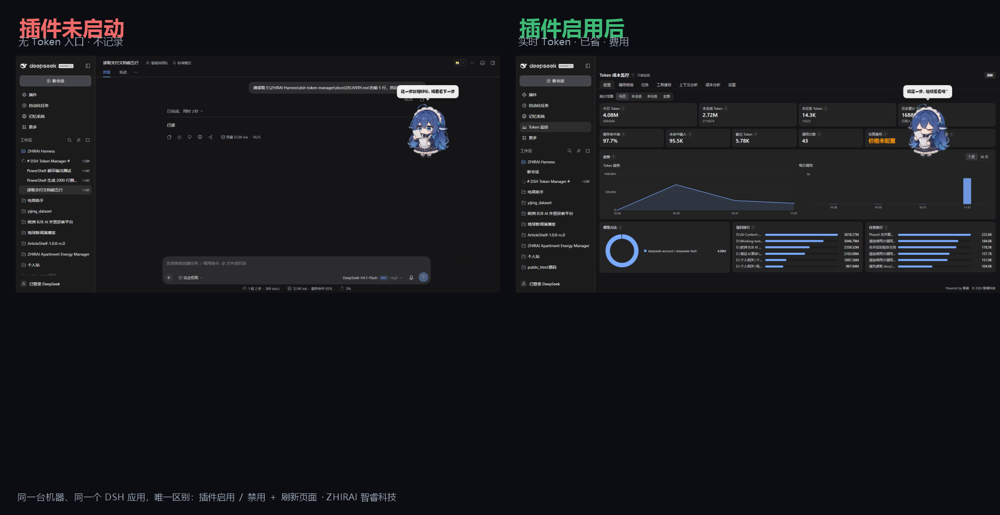
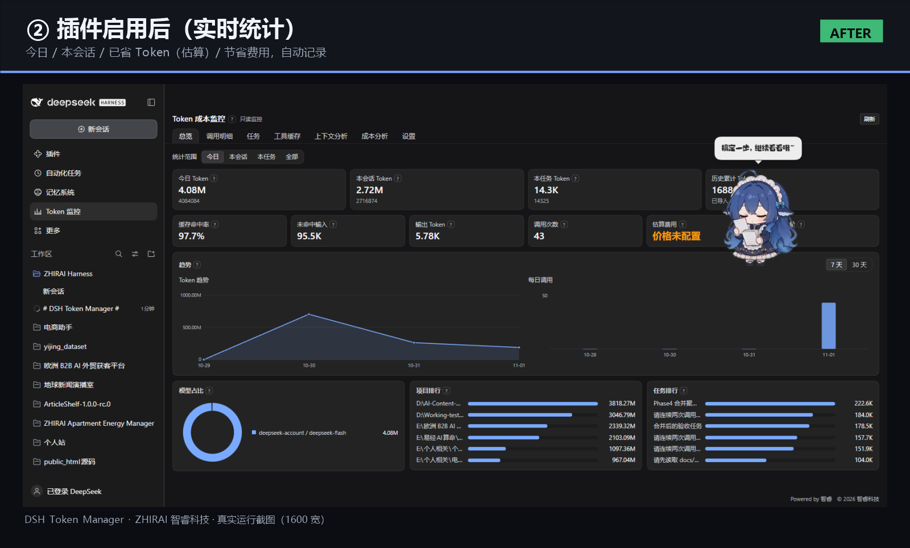
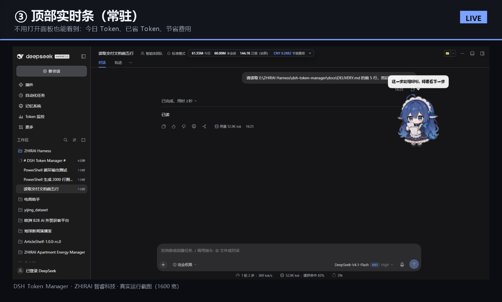
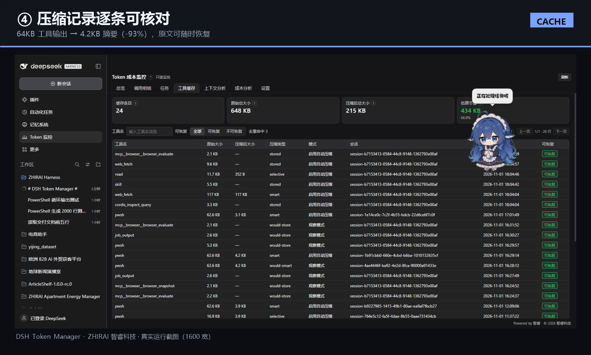
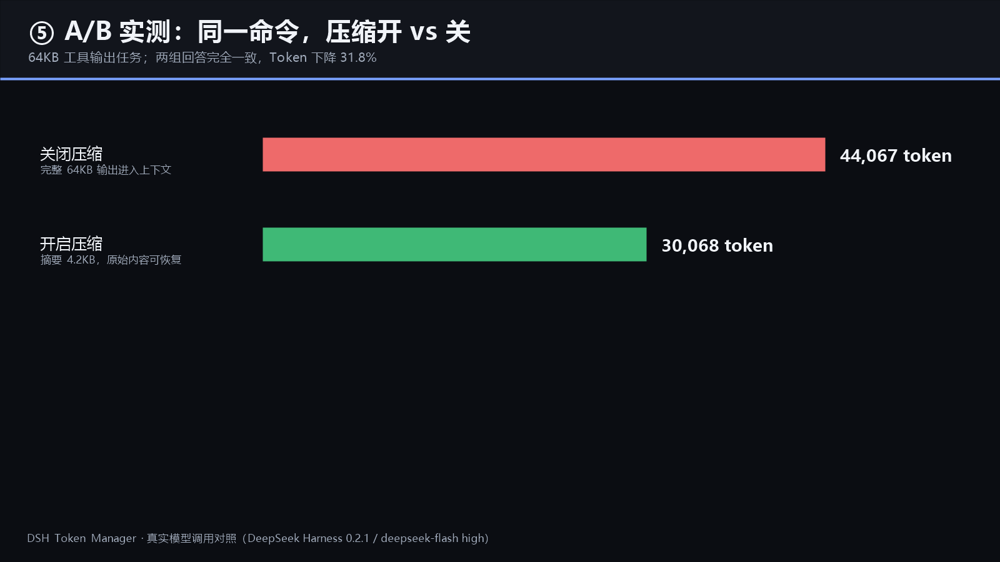

# DSH Token Manager

**English** | [简体中文](README.zh-CN.md)


[](https://github.com/deepseek-ai/deepseek-harness)
[](#development)
[](#distribution)
[-868e96)](#license)

**Token cost monitoring, model-call efficiency analysis and reversible tool-output caching for [DeepSeek Harness](https://github.com/deepseek-ai/deepseek-harness).**

ZHIRAI · 智睿科技 · independent developer


---



| Dashboard | Live top strip | Compression records |
|---|---|---|
|  |  |  |



> Real screenshots from a running DSH desktop app: **left = plugin disabled**, **right = plugin enabled** (same machine, only the plugin toggled). The A/B chart comes from a real model-call comparison: **44,067 → 30,068 tokens (−31.8%) with identical answers**.

---

## What it is

A Cordis plugin for DeepSeek Harness that answers four questions without touching the model, the reasoning level, the harness core or dsh-mnemon:

1. **Where did my tokens go?** Per-call four-bucket ledger, per task, session, project, today and all-time.
2. **Which calls are wasteful?** 11 finding types: repeated file reads, repeated tools, repeated build/test/deploy commands, redundant confirmations, repeated plans/summaries, simple-task step inflation, cache-hit drops, task-cost anomalies and more.
3. **What can be compressed safely?** Large shell/build/test/log outputs are replaced by structured summaries; the original is always recoverable via `token_manager_read`.
4. **What did it cost and save?** Cost per task with your price table, plus estimated tokens and money saved by compression.

| Area | Capability |
|---|---|
| **Accounting** | Per-call four buckets (uncached input / cache read / cache write / output), deduplicated by `(session, turn, step, attempt)`; totals cross-checked field-by-field against DSH's own `tokenUsage` projection. |
| **Efficiency analysis** | 11 finding types with per-type switches and thresholds; 5 task types with same-type historical baselines (median / p80). |
| **Compression 2.0** | Shell-output aware (file lists, JSON/JSONL, Markdown, git diff/log, build, test, logs); every error/warning line preserved with its original line number; `read` results and error results are **never** compressed; history/prefix is **never** rewritten. |
| **Recovery** | Content-addressed blobs; `token_manager_read` paginates the original by blob id or reads a file inside the session workspace. |
| **Tasks & projects** | Merge tasks, 9-field task summaries, versioned 8-section project summaries, JSON/Markdown/CSV export. |
| **Interface** | Chinese-first dark dashboard, live top strip, 1600 / 897 / 390 responsive, help text collapsed into `?` icons. |

## Measured (not marketing numbers)

| Scenario | Result |
|---|---|
| A/B, same command, compression off → on | **44,067 → 30,068 tokens (−31.8%)**, both answers identical |
| Accuracy check, 1500-line output, ask line count + exact error line | Both modes answered **identically and correctly** (1500 lines, exact L777 text, 1 ERROR / 1 WARNING) |
| Real 493k-token session (offline audit of 12 shell outputs) | 521,347 B → 169,738 B (**−67.4%**), error/warning lines preserved **20/20** |
| Historical projects, cumulative tokens avoidable (estimate) | large/long sessions **30%–50%**, small projects **5%–15%** |

> Percentages for historical projects are an offline estimate (compressed tokens × how many later calls would carry them). The A/B row is a real model call. Costs depend on your plan; the built-in reference prices are public list prices, not a live bill.

## Distribution build

This repository is a **distribution build**, not an open-source repository:

- `lib/` contains the compiled, minified host and client bundles that DSH loads;
- `src/` and `tests/` contain README notes only — sources and tests are **not published**;
- `scripts/` contains two real, usable helpers;
- the plugin is proprietary (**UNLICENSED**, all rights reserved).

| Path | Content |
|---|---|
| `lib/` | `index.js` (host, 197 KB) and `client.js` (browser, 188 KB), minified |
| `src/` | README only — source not published |
| `tests/` | README only — test-suite summary (231 tests), no test sources |
| `scripts/` | `token-report.mjs` (per-call token report), `install-sandbox.ps1` (isolated profile install) |
| `locale/` | Chinese and English dictionaries |
| `docs/` | install, config, troubleshooting, compression 2.0 report, market guide, video script, screenshots |
| `.github/` | issue templates |

## Install

**From GitHub (no market or npm needed):**

```bash
dsh plugin --profile <profile> add github:zhirai-tech/dsh-token-manager
```

Then restart the profile. This installs the compiled release (v1.3.3) from this repository.

**From this repository (local clone):**

```bash
# from this repository (linked dev install)
dsh plugin --profile <profile> add "file:<absolute-path-to-this-repo>"

# or from the release zip
#   download dsh-token-manager-1.3.1.zip, unzip, then install the unzipped folder
dsh <profile> --no-open      # restart the GUI
```

Or in the DSH desktop app: **Settings → Plugins → install from local directory**.

Verify: the sidebar shows **Token 监控** and `/token-manager/api/health` returns `ok: true`.

Full steps, upgrade and uninstall: [docs/INSTALL.md](docs/INSTALL.md).

### Requirements

DeepSeek Harness `0.2.x` (verified on `0.2.1-rc.5`), Node.js 24.x bundled with DSH, no network access, no API keys.

## Configuration

Everything lives in **Token 监控 → 设置**: collection switches, 11 analysis toggles and thresholds, price table (4 buckets, currency, unit), compression mode (`off` / `observe` / `on`) and thresholds, cache limits, context analysis (dry-run only).

Defaults are safe: monitoring on, **compression in observe mode** (records but never replaces), context analysis dry-run only. Auto-compression must be enabled explicitly.

Full reference: [docs/CONFIG.md](docs/CONFIG.md).

## Compatibility and safety

- **No core changes**: no edits to DeepSeek Harness, dsh-mnemon, the model configuration or the reasoning level.
- **dsh-mnemon coexistence**: messages injected by mnemon (`source.kind = "dsh-mnemon"`) are classified as *protected* and never compressed, deduplicated or removed (verified with real conversations; message hashes unchanged).
- **Local-only data**: `%DSH_HOME%\dsh-token-manager\` (SQLite + content-addressed blobs); no telemetry, no network calls.
- **HTTP boundary**: every request goes through DSH's connection fence; `token_manager_read` validates session ownership and confines path reads to the session workspace.
- **Reversible**: uninstall removes listeners, routes, tool and UI; data remains until you delete it.

## Repository layout

See `docs/`, `.github/` and the table above. Sources are not published; issues about behaviour, compatibility and security are welcome.

## Market

DSH's plugin market is a JSON index any static host can serve. This repository ships a ready index:

```
https://raw.githubusercontent.com/zhirai-tech/dsh-token-manager/main/docs/market/index.json
```

Add it under **Plugins → Discover → Add index source**. See [docs/MARKET.md](docs/MARKET.md) for the format and how to get listed in community catalogs.

## Development

The test suite (231 unit tests + real-history cross-check) is maintained privately and run before every release. The public repository intentionally contains no source or test files.

## License

**Proprietary / All rights reserved — UNLICENSED.** See [LICENSE](LICENSE). No permission is granted to copy, modify or redistribute without written permission.

---

<p align="center">
  <strong>ZHIRAI</strong> · 智睿科技<br/>
  Build Ideas Into Reality · 把想法变成现实<br/>
  <a href="https://zhirai.cloud">zhirai.cloud</a> · xtang3125@gmail.com<br/>
  © 2026 ZHIRAI. All Rights Reserved.
</p>
