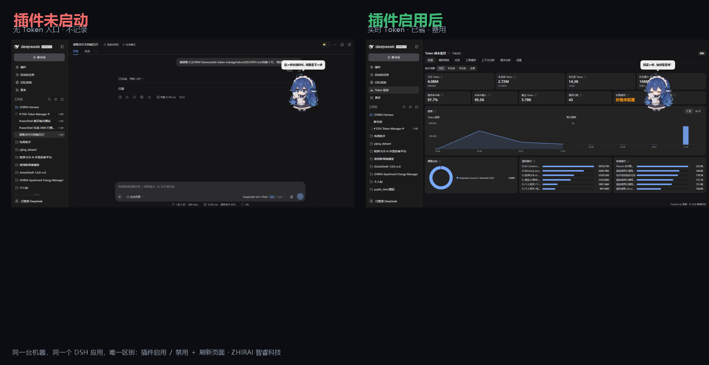
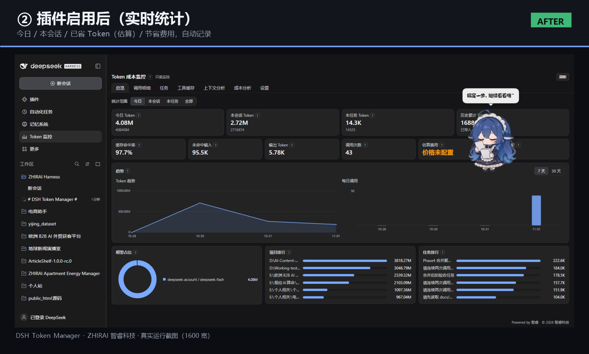
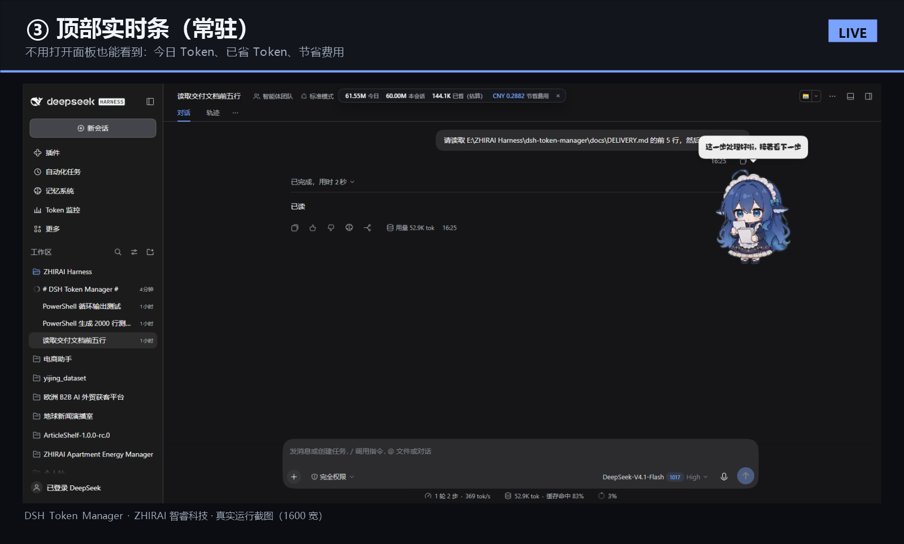
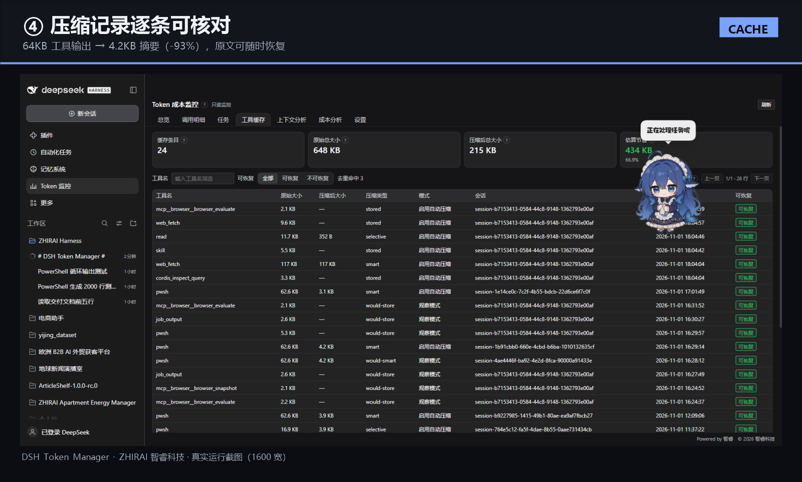
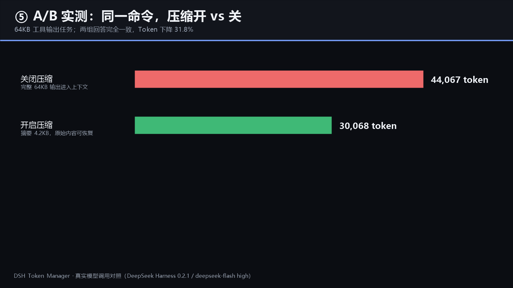
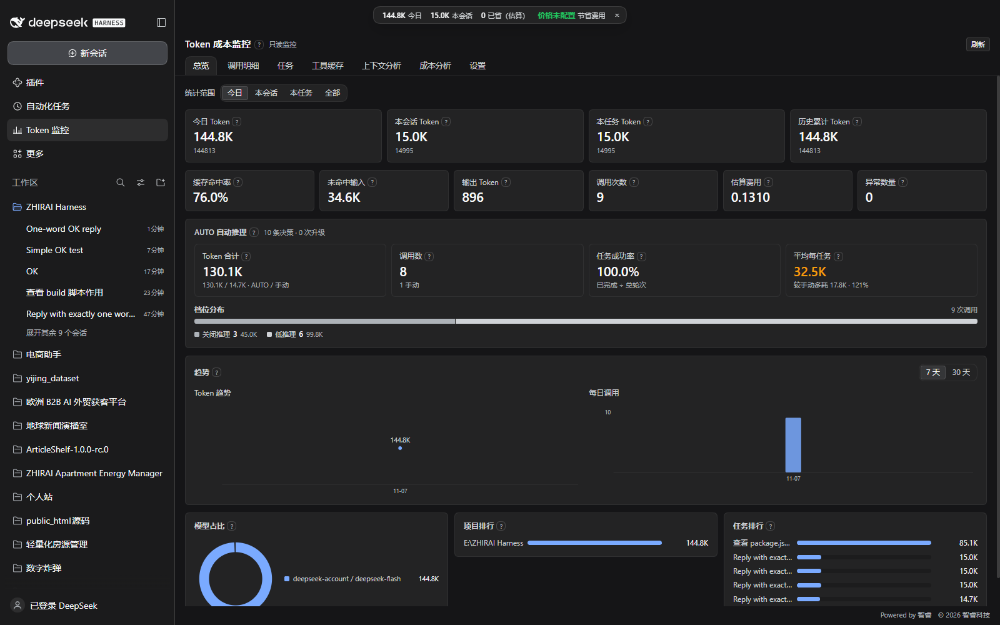
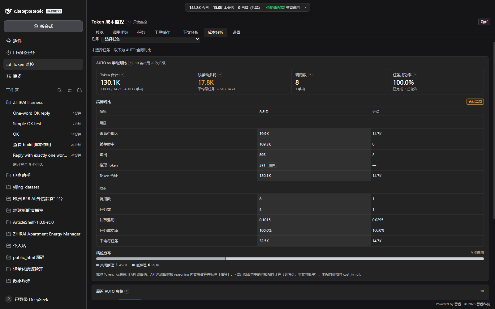
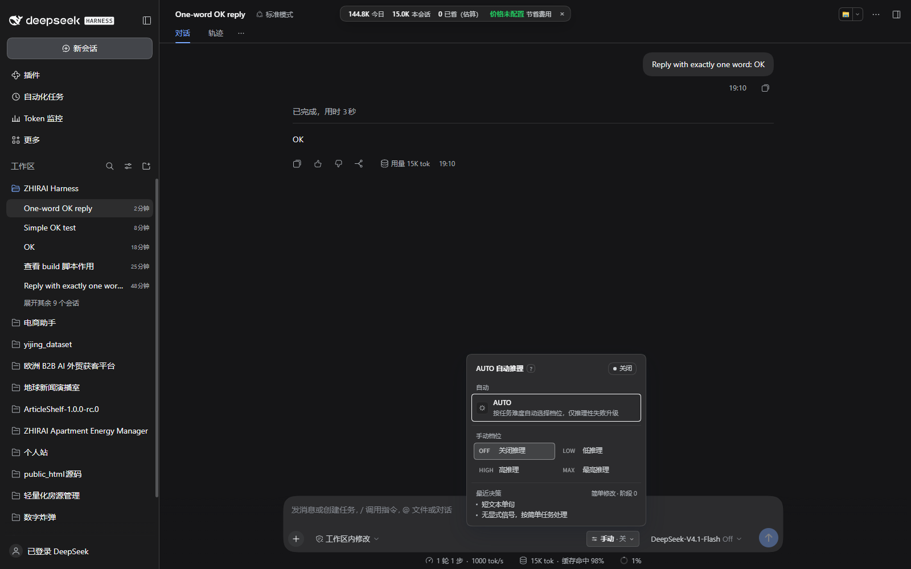
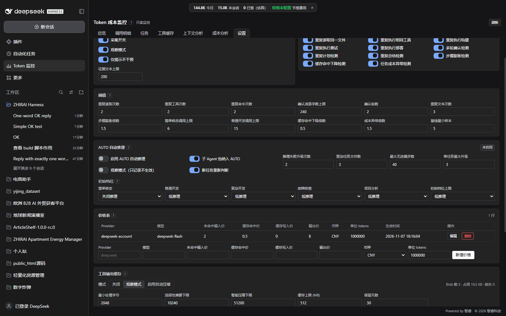

# 智控引擎 ControlX

<!-- BRAND:BEGIN (generated by node scripts/release/brand-sync.mjs — edit scripts/release/brand.mjs) -->
## 智控引擎 ControlX

**AI Resource Optimization Engine**

> 让 AI 更聪明地使用资源。

面向 AI Agent 的智能资源调度与效率优化引擎，通过动态推理控制、上下文优化、缓存管理与资源调度，让 AI 在保证任务质量的同时，以更少的资源消耗完成更多工作。

按需推理（Adaptive Reasoning）：根据任务难度动态选择推理深度，避免不必要的高强度推理。
精简上下文（Context Optimization）：只传递完成任务所需的信息，减少重复历史、重复文件和无效上下文。
智能调度（Intelligent Orchestration）：合理协调主 Agent、子 Agent、模型与资源，提高任务执行效率。
缓存复用（Cache Optimization）：减少重复计算与重复请求，提高已有结果的利用率。
质量与效率平衡（Quality & Efficiency）：不是单纯压低 Token，而是在保证任务质量的前提下优化整体资源利用率。

Repository: <https://github.com/zhirai-tech/dsh-token-manager> · Author: ZHIRAI
<!-- BRAND:END -->

[English](README.md) | **简体中文**


[](https://github.com/deepseek-ai/deepseek-harness)
[](#发行版说明)
[-868e96)](#许可)

**智控引擎 ControlX · AI Resource Optimization Engine** —— DeepSeek Harness（DSH）的 Token 成本监控、AUTO 自动推理调度与可逆上下文优化插件。

ZHIRAI · 智睿科技 · 独立开发者


---



| 仪表盘 | 顶部实时条 | 压缩记录 |
|---|---|---|
|  |  |  |



> 截图来自真实运行的 DSH 桌面应用：**左边插件未启动，右边插件启用后**（同一台机器，仅切换插件）。A/B 图来自真实模型调用对照：**44,067 → 30,068 token（−31.8%），两组回答完全一致**。

---

## 它解决什么问题

在不修改模型、不修改 Harness 核心、不绕过现有压缩/统计的前提下，回答五个问题：

1. **Token 花在哪了？** 逐调用四桶台账，按任务 / 会话 / 项目 / 今日 / 历史累计；输入/输出/推理/缓存命中/未命中分列，来源（API 真实值 / 估算 / 缺失）明确标注。
2. **哪些调用在浪费？** 15 类发现：重复读文件、重复工具、重复构建/测试/部署、多次确认、重复计划/总结、简单任务步骤膨胀、缓存命中下降、任务成本异常、子 Agent 继承历史、委派 prompt 过大、用量缺失/估算等。
3. **哪些可以安全压缩？** 大段命令/构建/测试/日志输出替换为结构化摘要，原文随时可用 `token_manager_read` 恢复；完全相同的重复结果可复用为引用。
4. **花了多少、省了多少？** 按你的价格表算任务费用，并估算压缩/复用节省的 Token 与费用。
5. **该用多强的推理？** **AUTO 自动推理**：按每个任务的真实难度自动选择 `OFF / LOW / HIGH / MAX`，逐级升级、只认推理性失败，手动档位完整保留。

| 模块 | 能力 |
|---|---|
| **计量** | 逐调用四桶（未命中输入 / 缓存命中 / 缓存写入 / 输出）+ 推理 token 来源；按 `(session, turn, step, attempt)` 去重；与官方 `tokenUsage` 逐字段核对一致 |
| **效率分析** | 15 类发现，可单独开关与设阈值；5 类任务 + 同类型历史基线（median / p80） |
| **AUTO 推理** | 每个任务独立判断：简单→OFF、普通/复杂→LOW 起步，靠写文件数/推理性失败/多方案未果逐级升到 HIGH/MAX；环境类失败（路径/权限/依赖/网络/命令）绝不升级；新任务重新判断不继承；手动选择即退出 AUTO |
| **上下文优化** | 完全相同工具结果复用（引用 + Blob 恢复）、`token_manager_context` 分层上下文包、子 Agent spawn/fork 审计（谁继承了完整历史、委派 prompt 多大） |
| **压缩 2.0** | 按 shell 输出分类（文件列表、JSON/JSONL、Markdown、git diff/log、构建、测试、日志）；**所有错误/警告行带原始行号保留**；`read` 结果与错误结果**永不压缩**；历史前缀**永不重写** |
| **恢复** | 内容寻址 blob；`token_manager_read` 按 blob id 分页读取，或读取会话工作目录内文件 |
| **任务/项目** | 任务合并、9 段任务摘要、8 段版本化项目摘要、JSON/Markdown/CSV 导出 |
| **界面** | 中文深色仪表盘、composer AUTO 控件、AUTO vs 手动成本对比、1600/897/390 自适应、说明收进 `?` |

## 实测数据（不是宣传数字）

| 场景 | 结果 |
|---|---|
| A/B：同一命令，压缩关 → 开 | **44,067 → 30,068 token（−31.8%）**，两组回答完全一致 |
| AUTO vs 手动 HIGH（同组 A–D 任务，真实调用） | 合计 **1,063,769 → 620,623 token（−41.7%）**，费用 −44.7%，耗时 −54.4%，成功率同为 4/4 |
| 环境失败任务（不该升推理）：手动 HIGH 错用 → AUTO | **617,106 → 147,417 token（−76.1%）**，费用 −77.7%；AUTO 全程 LOW + hold，不升档 |
| 任务切换：复杂任务升到 MAX 后，新简单任务 | 重新判定为 **OFF**，不继承上一任务档位 |
| 准确性核对：1500 行输出，问行数 + 第 777 行原文 | 两种模式回答**完全一致且正确**（1500 行、原文精确、ERROR 1 / WARNING 1） |
| 真实 493k token 会话（12 条 shell 输出离线审计） | 521,347 B → 169,738 B（**−67.4%**），错误/警告行保留 **20/20** |
| 历史项目累计可避免 Token（估算） | 大型/长会话 **30%–50%**，小项目 **5%–15%** |

> 历史项目百分比是按“被压缩 Token × 后续携带它的调用次数”的离线估算；A/B 与 AUTO 对比是真实模型调用（DeepSeek `deepseek-account/deepseek-flash`），费用按内置参考价估算、非实时账单。AUTO 相比一律 LOW 会多约 12% Token —— 这是它在复杂任务上真正升级换质量余量的成本；相比一律 HIGH 则省 41.7%。

## AUTO 自动推理（v1.4.0）

在 composer 模型选择器旁新增 **AUTO** 控件。开启后仍可随时手动选档位；手动选档即退出 AUTO，原有手动行为完全不变。

| AUTO vs 手动（同组 A–D 任务，真实调用） | 手动 HIGH | AUTO | 变化 |
|---|---|---|---|
| 合计 Token | 1,063,769 | 620,623 | **−41.7%** |
| 费用（参考价估算） | ¥0.8347 | ¥0.4612 | **−44.7%** |
| 耗时 | 271.0s | 123.5s | **−54.4%** |
| 成功率 | 4/4 | 4/4 | 相同 |

- 简单任务（改按钮颜色/文案/查询）→ **OFF**；普通任务 → **LOW**；证据（多文件/推理性失败/多方案未果）出现才逐级升 **HIGH/MAX**，单任务最多 3 次、从不跳档。
- **环境类失败绝不升级**：路径不存在、权限、依赖缺失、网络、命令不存在、测试环境、外部 API —— 只记录 failureKinds。同类环境失败任务里，AUTO 比「手动 HIGH 硬推」省 **76% Token**。
- **任务之间独立判断**：上一个任务升到 MAX，下一个简单任务仍从 OFF 开始（实测）。
- 每次决策留痕（原因/证据/是否生效），成本分析页可看 AUTO vs 手动对比与决策历史。

| 总览 · AUTO 面板 | 成本分析 · AUTO vs 手动 |
|---|---|
|  |  |

| Composer · AUTO 菜单 | 设置 · AUTO 配置 |
|---|---|
|  |  |

## 发行版说明

本仓库是**发行版**，不是开源仓库：

- `lib/` 是编译压缩后的 host/client 产物（DSH 实际加载的文件）；
- `src/`、`tests/` 只有说明文件——源码与测试**不公开**；
- `scripts/` 是两个真实可用的辅助脚本；
- 插件为专有软件（**UNLICENSED**，保留所有权利）。

| 路径 | 内容 |
|---|---|
| `lib/` | `index.js`（host，约 522KB）、`client.js`（浏览器，约 361KB），已压缩 |
| `src/` | 仅说明：源码不发布 |
| `tests/` | 仅说明：测试套件概况（350 项），不含测试源码 |
| `scripts/` | `token-report.mjs`（逐调用 Token 报告）、`install-sandbox.ps1`（隔离 profile 安装） |
| `locale/` | 中英文语言包 |
| `docs/` | 安装、配置、故障排查、压缩 2.0 报告、市场说明、视频脚本、截图 |
| `.github/` | Issue 模板 |

## 安装

```bash
# 从本仓库安装（链接式开发安装）
dsh plugin --profile <profile> add "file:<本仓库绝对路径>"

# 或从 Release 包安装
#   下载 dsh-token-manager-1.4.0.zip 解压，再安装解压目录
dsh <profile> --no-open
```

或在 DSH 桌面版：设置 → 插件 → 从本地目录安装。

验证：左栏出现「智控引擎 ControlX」，`/token-manager/api/health` 返回 `ok: true`。

完整步骤、升级、卸载见 [docs/INSTALL.md](docs/INSTALL.md)。

### 环境要求

DeepSeek Harness `0.2.x`（本机验证 0.2.1-rc.5）、DSH 自带 Node.js 24.x、无需联网、无需 API Key。

## 配置

全部在「智控引擎 ControlX → 设置」：采集开关、11 类分析开关与阈值、价格表（四桶 / 币种 / 单位）、压缩模式（关闭 / 观察 / 启用）与阈值、缓存上限、上下文分析（仅 dry-run）。

默认是安全模式：监控开、**压缩为观察模式**（只记录不替换）、上下文分析只检测。自动压缩需手动开启。

逐项说明见 [docs/CONFIG.md](docs/CONFIG.md)。

## 兼容与安全

- **不改核心**：不修改 Harness 核心、dsh-mnemon、模型配置与推理等级；
- **与 dsh-mnemon 共存**：mnemon 注入消息标记为受保护，不压缩、不去重、不删除（真实会话哈希前后一致）；
- **数据本地**：`%DSH_HOME%\dsh-token-manager\`（SQLite + 内容寻址 blob），无遥测、无网络请求；
- **HTTP 边界**：所有请求经 DSH 连接围栏；`token_manager_read` 校验会话归属、路径限制在工作目录；
- **可逆**：卸载后监听器、路由、工具、UI 全部移除，数据保留到用户删除。

## 市场

DSH 市场本质是一个 JSON 索引，本仓库内置：

```
https://raw.githubusercontent.com/zhirai-tech/dsh-token-manager/main/docs/market/index.json
```

在「插件 → 发现 → 添加索引源」填入即可。索引格式与社区目录收录见 [docs/MARKET.md](docs/MARKET.md)。

## 许可

**专有软件 / 保留所有权利（UNLICENSED）**，详见 [LICENSE](LICENSE)。未经书面许可，不得复制、修改或再分发。

---

<p align="center">
  <strong>ZHIRAI</strong> · 智睿科技<br/>
  把想法变成现实 · Build Ideas Into Reality<br/>
  <a href="https://zhirai.cloud">zhirai.cloud</a> · xtang3125@gmail.com<br/>
  © 2026 智睿科技 保留所有权利。
</p>
