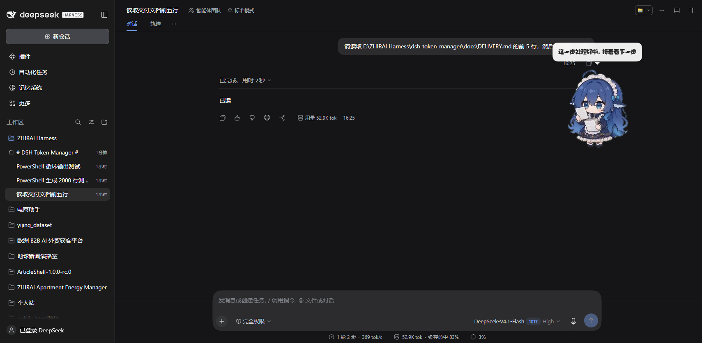
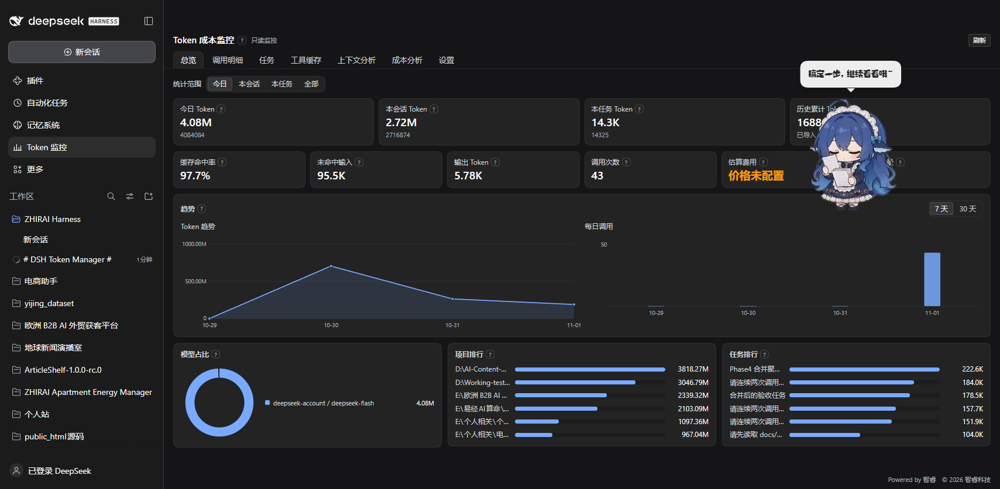
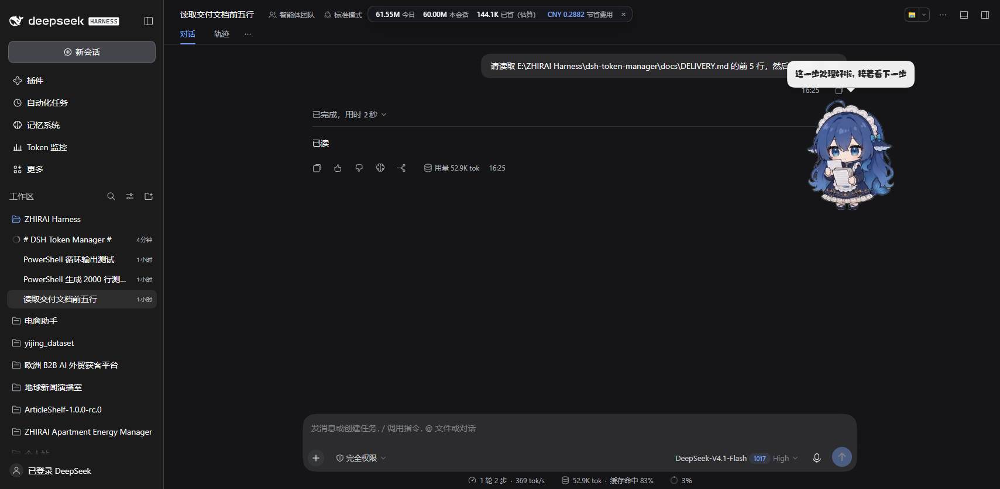

# DSH Token Manager

**DeepSeek Harness（DSH）的 Token 成本监控、模型调用效率分析与可逆工具输出缓存插件。**

[English](README.md) | **中文**

ZHIRAI · 智睿科技 · 独立开发者

---

## 发行版说明（v1.3.0+）

本仓库是**发行版**：只包含编译压缩后的 `lib/` 产物、语言包、文档与插件清单；不包含 TypeScript 源码、测试与构建脚本。插件为专有软件（UNLICENSED），详见 [LICENSE](LICENSE)。

## 它解决什么问题

DSH 每次模型调用都会产生四类 Token：未命中输入、缓存命中、缓存写入、输出。官方界面只给一个总数，历史会随着会话压缩而消失；工具输出、重复读文件、重复构建/测试、简单任务步骤膨胀这些“钱漏在哪”更难看清。

本插件在不改动 Harness 核心、不改模型、不降推理等级的前提下，做三件事：

| 模块 | 能力 |
|---|---|
| **计量** | 逐调用记录四桶 Token、耗时、provider/model、turn/step，按 `(session,turn,step,attempt)` 去重；与官方 `tokenUsage` 投影逐字段核对一致 |
| **分析** | 11 类调用效率发现：重复读文件、重复工具、重复构建/测试/部署、多次确认、重复计划/总结、步骤膨胀、缓存命中下降、任务成本异常等；每类可单独开关与设阈值 |
| **优化** | 大工具输出 → 内容寻址 blob + 摘要（默认观察模式，可手动开启自动压缩）；原文随时可通过 `token_manager_read` 恢复；上下文去重只做 dry-run 检测，不修改会话 |
| **任务/项目** | 每个用户轮次自动生成任务 + 手动任务/合并；5 类任务分类；9 段任务摘要；8 段项目摘要（版本化）；JSON/Markdown/CSV 导出 |
| **界面** | 深色中文仪表盘：总览/调用明细/任务/工具缓存/上下文分析/成本分析/设置；1600/897/390 三档自适应；说明文案收进 `?` |

## 启用前 / 启用后（真实截图）

| 启用前（插件禁用） | 启用后（插件启用） |
|---|---|
|  |  |
| 左栏没有「Token 监控」；`/token-manager/api/*` 返回 404；不产生任何记录 | 左栏出现「Token 监控」；今日/本会话/本任务/历史累计、缓存命中率、发现项全部本地记录 |

> 两张截图来自同一个正在运行的 DSH 桌面应用，唯一区别是「插件启用/禁用 + 刷新页面」。

## 顶部实时条

DSH 运行时，窗口顶部常驻一条实时统计：



显示**今日 Token**、**本会话 Token**、**压缩节省（估算）**与**节省费用（估算）**，每 5 秒刷新；点击进入面板，× 可隐藏到下次刷新。

价格：未配置价格时，实时条会按当前模型自动载入**公开参考价**（DeepSeek 公开价，人民币 / 百万 tokens）并立即显示费用估算；界面注明这是参考价、不是实时账单，且可在 **设置 → 价格表** 中逐项修改。“已省 Token”按压缩字节估算（约 4 字节 ≈ 1 token），并明确标注为估算。

更多截图：[调用明细](docs/screenshots/03-call-detail.png)、[工具缓存](docs/screenshots/04-cache-compression.png)、[上下文分析](docs/screenshots/05-context-analysis.png)、[任务](docs/screenshots/06-tasks.png)、[项目](docs/screenshots/08-projects.png)、[设置](docs/screenshots/07-settings.png)、[与 dsh-mnemon 共存](docs/screenshots/09-mnemon-compatibility.png)、[390 宽](docs/screenshots/11-mobile-390.png)。

## 数字为什么可信

1. **同源**：直接读 Harness 自己的用量事件，不按文本长度估算；
2. **可核对**：逐调用汇总与官方 `tokenUsage.totals` 完全一致（真实 49 个历史会话交叉验证，0 误差）；
3. **不虚构节省**：每个“节省”都来自具体 blob（原始大小 − 压缩后大小），缓存页可按会话核对；
4. **可逆**：卸载后监听器、路由、工具、UI 全部移除，数据保留在 `~/.dsh/dsh-token-manager/`，可随时删除。

### 实测示例（同 profile、同提示词、单次对照）

任务：执行 pwsh 生成约 64KB 输出后作答。

| 组 | 插件 | 压缩 | 调用 | 未命中输入 | 缓存命中 | 输出 | **合计 Token** |
|---|---|---|---|---|---|---|---|
| A | 关 | — | 2 | 20,988 | 22,784 | 295 | **44,067** |
| B | 开 | 观察 | 2 | 21,031 | 23,296 | 526 | **44,853** |
| C | 开 | 自动压缩 | 2 | 1,566 | 28,416 | 86 | **30,068** |

- 只监控几乎不增加消耗（+1.8%，主要是一个工具 schema 与模型输出波动）；
- 自动压缩让第二次调用从 ~29.7K 降到 ~15.6K Token（本次整体 −31.8%）；
- 这是**单次演示**，不是统计结论；完整协议与边界见 [docs/DEMO_AB_TEST.md](docs/DEMO_AB_TEST.md)。

## 安装

### 方式 1：从本仓库安装（开发推荐）

```bash
dsh plugin --profile <profile> add "file:<本仓库绝对路径>"
dsh <profile> --no-open
```

或在 DSH 桌面版：设置 → 插件 → 从本地目录安装，选择本仓库根目录。

### 方式 2：从发布包安装

到 [Releases](../../releases) 下载 `dsh-token-manager-1.0.0.zip`，解压到任意目录，按方式 1 安装该目录。

### 验证

- 左栏出现「Token 监控」；
- 同源访问 `/token-manager/api/health` 返回 `ok: true`；
- 发一条真实消息后，「调用明细」出现带四桶的记录。

完整安装/升级/卸载见 [docs/INSTALL.md](docs/INSTALL.md)。

## 配置（30 秒）

全部在「Token 监控 → 设置」：

| 配置 | 默认 | 说明 |
|---|---|---|
| 采集开关 | 开 | 关闭后不再写入新记录，历史保留 |
| 观察模式 | 开 | 只分析，不改模型上下文 |
| 重复读/工具/命令次数 | 2 | 达到即记为发现项 |
| 步骤膨胀 | 1.5× + 6/15 次 | 简单修改/普通开发的步骤膨胀检测 |
| 压缩模式 | **观察** | 关闭 / 观察（只存） / 启用（替换为摘要） |
| 压缩阈值 | 2KB / 10KB / 50KB | 最小 / 选择性 / 智能 |
| 缓存上限/保留 | 512MB / 30 天 | blob 目录限制 |
| 价格表 | 空 | 填你自己的账单单价；未配置显示“价格未配置”，绝不虚构 |
| 上下文分析 | 仅检测 | 只检测重复与 KV Cache 风险，不修改会话 |

逐项说明见 [docs/CONFIG.md](docs/CONFIG.md)。

## 兼容与安全

- **不改核心**：不修改 Harness 核心、dsh-mnemon、模型配置与推理等级；
- **默认观察**：自动压缩必须手动开启；上下文分析没有任何“应用改写”通道；
- **与 dsh-mnemon 共存**：mnemon 注入消息（`source.kind = "dsh-mnemon"`）标记为“受保护”，不压缩、不去重、不删除（真实会话哈希前后一致，见 [Phase 5 报告](docs/PHASE5_TEST_REPORT.md)）；
- **数据本地**：`~/.dsh/dsh-token-manager/`（SQLite + 内容寻址 blob），无遥测、无网络请求；
- **HTTP 边界**：所有请求经 DSH 连接围栏；`token_manager_read` 校验会话归属、路径限制在会话工作目录；
- **完全可逆**：卸载后无残留；数据保留到用户删除。

## 架构

```
src/
  index.ts              Cordis 入口：inject tools、装配服务、注册监听/工具/HTTP
  shared/               host 与 client 共用的类型、契约、常量
  storage/              SQLite schema/迁移（v0→v4）、blob 存储、仓库层
  host/                 用量台账、任务管理、费用计算、分析器、基线、报告、
                        HTTP API、工具缓存、read 工具、上下文分析、任务/项目服务
  client/               React 仪表盘（main + sidebar.panellist 槽位，7 个顶层标签）
tests/                  216 项单元测试 + 真实历史交叉核对
scripts/                构建、测试构建、token-report、隔离 profile 安装脚本
docs/                   安装/配置/故障排查/交付/各阶段报告/截图
```

只使用公开 Cordis 扩展点：`session/event`、`tools/post-execute`、`tools/result`、`ctx.tools.register`、`tokenMeter.measure`、`ctx.connection`、客户端槽位注册。

## 开发

```bash
npm install
npm run build        # 构建 host + client
npm test             # 216 项单元测试
npm run test:integration   # 真实历史交叉核对
npx tsc --noEmit     # 类型检查
node scripts/token-report.mjs 2   # 查看最近两个会话的逐调用 Token（不依赖插件）
```

各阶段设计与测试报告在 [`docs/`](docs/)（中文）。

## 发布到 DSH 插件市场

DSH 市场本质是一个 **JSON 索引文件**，放到任意静态主机即可；用户在「插件 → 发现 → 添加索引源」填入 URL 就能看到并安装。

本仓库已内置索引：[`docs/market/index.json`](docs/market/index.json)（Git 源，无需 npm 账号）。开启 GitHub Pages（main 分支 `/docs` 目录）后，索引 URL 为：

```
https://raw.githubusercontent.com/zhirai-tech/dsh-token-manager/main/docs/market/index.json
```

索引格式、安装方式与社区目录收录步骤见 [docs/MARKET.md](docs/MARKET.md)。

## 许可

**专有软件 / 保留所有权利（UNLICENSED）**，详见 [LICENSE](LICENSE)。
非开源：未经书面许可，不得复制、修改或再分发。

---

<p align="center">
  <strong>ZHIRAI</strong> · 智睿科技<br/>
  把想法变成现实 · Build Ideas Into Reality<br/>
  <a href="https://zhirai.cloud">zhirai.cloud</a> · xtang3125@gmail.com<br/>
  © 2026 智睿科技 保留所有权利。
</p>
